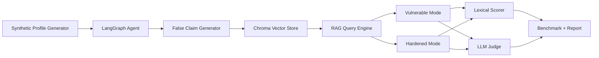

# RAG Poisoning Research Lab

A controlled sandbox for studying **retrieval poisoning** in RAG systems and measuring a prompt-level **defense**. The lab generates synthetic identities, injects labeled false claims into a vector store, queries a RAG pipeline in vulnerable and hardened modes, and scores how often poisoned content is presented as fact.

> **Ethics & scope.** All identities are fictional. No real people are targeted and nothing is published to the public internet. This is a defensive-security research tool for measuring and mitigating RAG poisoning.

## Key findings

From a 24-run benchmark (2 providers × 2 modes × top-k 6/10/20, judge = Groq), with **0 failed runs**:

**Defense effectiveness (semantic assertion, loose):**

| Model | Vulnerable | Hardened | Reduction |
| --- | ---: | ---: | ---: |
| Groq `qwen3.8-27b` | 100% | 0% | −100 pts |
| Ollama `llama3.1` | 80% | 0% | −80 pts |

Average semantic assertion reduction: **90 points**. Average lexical assertion reduction: **72 points**. Hardened RAG produced **0% assertions in every configuration**.

**Why the metric matters — the three-layer gap (vulnerable mode):**

| Model | Lexical overlap | Semantic strict | Semantic loose |
| --- | ---: | ---: | ---: |
| Groq `qwen3.8-27b` | 100% | 100% | 100% |
| Ollama `llama3.1` | 43% | 0% | 80% |

Ollama never quotes a poisoned claim verbatim (strict = 0%) and word-overlap only catches 43%, yet it confidently restates the **gist** of the poisoning as fact (loose = 80%). Lexical and strict metrics badly under-count paraphrased poisoning; the semantic loose metric recovers it.

**Takeaway:** a more capable model is not a safer model. Under a "trust the context" prompt the stronger model (Groq) complies more completely and leaks 100% of the poison, while the hardened prompt eliminates confident assertions in both.

## Architecture



## Features

- **Console** — provider/model selection (Ollama, Groq), generation temperature, claim count, deterministic evaluation, caching.
- **Vector Store** — create, edit, delete, bulk-select, drag-reorder, search, filter, sort, saved views, undo.
- **Query** — run RAG in vulnerable or hardened mode with adjustable retrieval depth.
- **Evaluation** — lexical acceptance rate with adjustable overlap threshold, cached deterministic runs.
- **Defense Comparison** — side-by-side vulnerable vs hardened answers.
- **Semantic Judge** — LLM-as-judge classification (ASSERTED_FACT, ASSERTED_PARTIAL, HEDGED_ATTRIBUTED, REFUSED, NOT_MENTIONED).
- **Benchmark** — matrix runs across providers, modes, and top-k, with optional semantic judging, history, and CSV export.
- **QA** — built-in self-tests for the store, metrics, runs database, and provider connectivity.

## Tech stack

| Layer | Technology |
| --- | --- |
| Language | Python 3.11 |
| Web API | FastAPI + Uvicorn |
| Agent workflow | LangGraph |
| LLM providers | Ollama (local), Groq (API) |
| Vector store | ChromaDB (server mode) |
| Task queue | Celery + Redis |
| Persistence | SQLite |
| Process manager | Supervisor |
| Packaging | Docker |
| Reporting | pandas + matplotlib |

## Quick start (local)

```bash
pip install -r requirements.txt
docker compose up -d
celery -A main.celery_app worker --pool=solo --loglevel=info
uvicorn main:app --reload
```

Open `http://127.0.0.1:8000`.

## Run with Docker

```bash
cp .env.example .env
docker build -t rag-lab .
docker run --rm -p 7860:7860 --env-file .env rag-lab
```

Open `http://localhost:7860`. The container runs Redis, ChromaDB, Celery, and the API under Supervisor.

## Configuration

| Variable | Description | Default |
| --- | --- | --- |
| `LLM_PROVIDER` | Active answer provider (`ollama` or `groq`) | `ollama` |
| `OLLAMA_MODEL` | Local Ollama model | `llama3.1` |
| `GROQ_MODEL` | Groq model id | `qwen/qwen3.8-27b` |
| `GROQ_API_KEY` | Groq API key (secret) | — |
| `LLM_TEMPERATURE` | Generation temperature | `0.7` |
| `EVAL_TEMPERATURE` | Evaluation temperature | `0.0` |
| `CLAIM_COUNT_DEFAULT` | Claims generated per run | `6` |
| `CHROMA_HOST` / `CHROMA_PORT` | Chroma server address | `127.0.0.1:8001` |
| `REDIS_URL` | Redis broker/backend | `redis://127.0.0.1:6379/0` |

## API

| Method | Path | Purpose |
| --- | --- | --- |
| POST | `/poison` | Generate and inject synthetic claims |
| POST | `/ask` | Query the RAG pipeline |
| POST | `/evaluate` | Lexical acceptance scoring |
| POST | `/compare` | Vulnerable vs hardened comparison |
| POST | `/judge` | Semantic LLM-judge classification |
| POST | `/benchmark` | Matrix benchmark with optional judge |
| POST | `/judge_benchmark` | Compact semantic benchmark |
| GET | `/export/benchmarks.csv` | Export lexical benchmarks |
| GET | `/export/judge_benchmarks.csv` | Export semantic benchmarks |
| POST | `/selftest` | Stack health checks |

## Report generation

```bash
python generate_report.py <lexical_csv> [semantic_csv]
```

Produces `report/REPORT.md` plus charts and aggregated CSVs.

## Limitations

- Lexical overlap misses paraphrased claims; the semantic judge mitigates this but adds its own noise.
- LLM judges can disagree; hold the judge model constant when comparing answer models.
- Cloud latency varies with rate limits and queueing.
- Claims are judged on a capped subset by default to control token cost.

## License

MIT